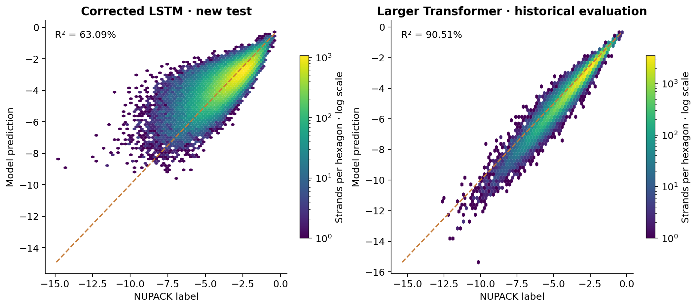
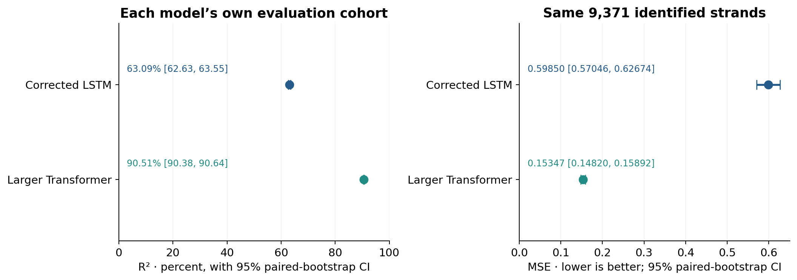
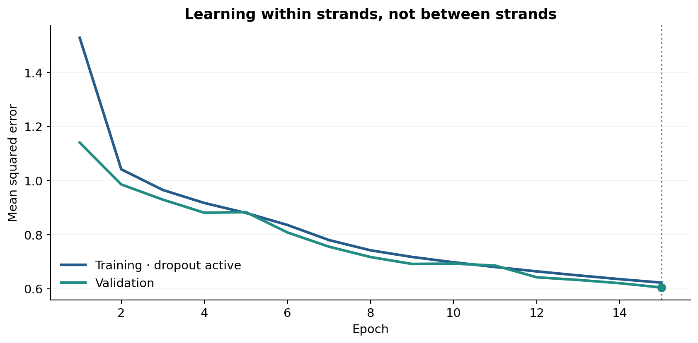

# DNA Free-Energy Prediction with Neural Networks

Can neural networks learn the folding free energies calculated by NUPACK?

The [new notebook](New_version_with_LSTM_fixed.ipynb) examines a corrected LSTM and the original larger Transformer's saved predictions. It uses the original dataset of one million random 30-base DNA strands, with regression diagnostics, confidence intervals and paired statistical tests.

## Regression results

| Model | Evaluation strands | MSE (95% CI) | R² (95% CI) |
| --- | ---: | ---: | ---: |
| Corrected LSTM | 100,000 new held-out strands | 0.59955 [0.59119, 0.60806] | 63.09% [62.63%, 63.55%] |
| Larger Transformer, saved checkpoint | 100,000 historical evaluation strands | 0.15640 [0.15448, 0.15825] | 90.51% [90.38%, 90.64%] |

R² measures the fraction of the evaluation labels' centered variation removed by prediction. It is calculated from squared prediction errors, not squared correlation. The two full evaluation cohorts differ; the paired comparison below uses only identified shared strands.

## Statistical inference

We resample whole label–prediction pairs 2,000 times with fixed seeds. A one-sided, studentized, null-centered bootstrap tests whether each mean squared-error reduction is positive. Constant benchmarks use training-label means; the Transformer's mean is reconstructed from the documented 90%/10% split and complete label sums.

| Comparison | Strands | Mean MSE reduction | Pointwise 95% CI | Holm-adjusted p |
| --- | ---: | ---: | ---: | ---: |
| Corrected LSTM vs training mean | 100,000 | 1.02481 | [1.00870, 1.04131] | 0.0015 |
| Larger Transformer vs training mean | 100,000 | 1.49167 | [1.47247, 1.51064] | 0.0015 |
| Larger Transformer vs corrected LSTM | 9,371 shared strands | 0.44503 | [0.41721, 0.47309] | 0.0015 |

All three raw Monte Carlo p-values are approximately **0.0005**: none of the 2,000 null resamples exceeded the observed statistic. This is the simulation's resolution, not an exact tail probability. Holm adjustment covers these three retrospective comparisons; the 95% intervals are pointwise.

On the shared cohort, MSE is **0.59850 for the LSTM** and **0.15347 for the Transformer**. The paired results favor the Transformer on those strands. The confidence-interval figure separates each model's full-cohort R² from this common-cohort comparison.

## Correcting the LSTM

The original input flattened each strand to 120 values, causing unrelated strands to become successive recurrent steps. The corrected shape is **[batch, 30 bases, 4 nucleotide indicators]**, so the network processes bases within each strand independently.

The corrected model has two LSTM layers, 64 hidden units and 51,265 parameters. Fresh training used an 800,000/100,000/100,000 training–validation–test split, Adam with learning rate 0.001, and a 15-epoch limit. Checkpoint selection used validation MSE. Strand-independence and saved-weight checks passed. The smaller architecture and new split prevent attributing the improvement solely to the input correction.

## Interpretation and limitations

The analysis is **retrospective and exploratory**. The larger Transformer's evaluation set was monitored historically: its intervals and p-values are **not adjusted for checkpoint selection**. Its saved-checkpoint MSE is 0.1564; the report's best value of 0.12 is a different result and is not assigned an invented confidence interval.

Shared strands are reconstructed only where a canonical float32 label uniquely identifies a sequence in the original dataset. All 6,212 ambiguous historical rows are excluded from matching. The resulting 9,371-strand subset is not necessarily representative of all sequences.

Bootstrap inference assumes independent randomly generated strands and is conditional on the fitted models. It excludes retraining variability and does not establish an architecture-wide ranking. Error diagnostics also show remaining bias and uneven accuracy across the energy range. These are NUPACK-generated targets, not experimental measurements or binding affinities.

The [executed notebook](New_version_with_LSTM_fixed.ipynb) contains the calculations and saved figures. [Supporting files](corrected_lstm/) include weights, prediction pairs, split indices, the inference plan, tests and dependencies. Existing research notebooks remain unchanged.

---

# Welcome to our aptamers Gibbs free energy prediction project!

## The "doc" folder
The doc folder contains all the .tex source files of different reports we had to routinely furnish. The "images" subfolder contains all the graphics included in said reports.

## The "src" folder
The src folder contains all the Jupyter and Python scripts we used in order to create our datasets and train our models. Most of our experiments were written in Jupyter and are self-descriptive. You only need to press the "run all cells" button and it should work. When the training of our models is finished, the scripts generate serialized files containing the weights of our models. These saved models were used in some other files in order to provide additionnal results for the analysis section of our report. Inside the  "results" subfolder, you will find some code we used in order to analyse and generate more results.
Inside the "data" subfolder, you will find our dataset in *Json* format and the code we wrote in order to generate it with the NUPACK library. To run the dataset generation code on your own, you will need to install the NUPACK library on your machine https://www.nupack.org/download/overview. 
